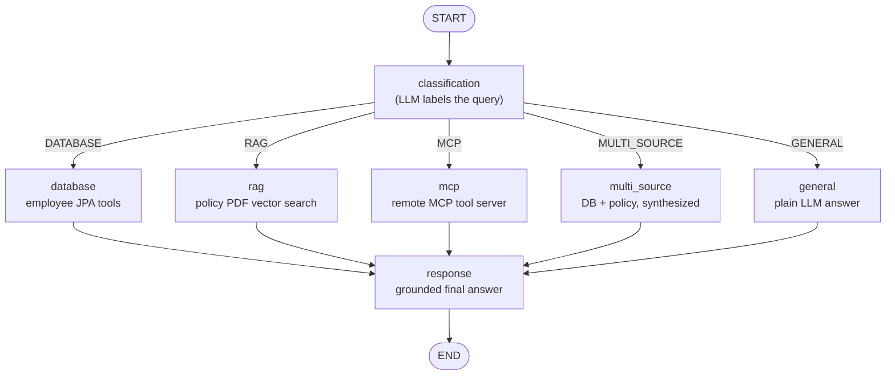

# Enterprise Knowledge Assistant (LangGraph4j · Java)

An agentic enterprise assistant built with **Spring Boot**, **Spring AI**, and **[LangGraph4j](https://github.com/bsorrentino/langgraph4j)**. A user question enters a compiled **state graph** that first *classifies* the intent, then *routes* it to the right knowledge source — a relational database, a RAG document store, a remote MCP tool server, or a combination — and finally composes a grounded answer.

```
 POST /api/chat                 ┌──────────────┐
   { "question": ... }  ─────▶  │ State Graph  │
                                └──────┬───────┘
                        ┌─────── classify + route ───────┐
                        ▼         ▼        ▼        ▼     ▼
                    database     rag      mcp  multi_source general
                        └─────────┴────────┴────────┴───────┘
                                       ▼
                                   response ──▶ grounded answer
```

## Modules

| Module | Role | Port |
| --- | --- | --- |
| [`enterprise-knowledge-assistant-application`](enterprise-knowledge-assistant-application) | The agent: LangGraph4j state graph, classification + routing nodes, RAG vector store, employee DB tools, MCP client, `/api/chat` REST API | `8080` |
| [`enterprise-knowledge-assistant-mcp`](enterprise-knowledge-assistant-mcp) | A standalone **MCP server** exposing client-portfolio tools over SSE, backed by an H2 database | `8085` |

## Tech stack

- **Java 21**, **Spring Boot 4.1.2**, **Maven** (wrapper included)
- **Spring AI 2.0.1** — OpenAI chat model, MCP client/server starters, PDF document reader, vector store
- **LangGraph4j 1.8.27** — graph-based agent orchestration
- **OpenAI** `gpt-4.1-mini` for classification and generation
- **H2** in-memory database + **Spring Data JPA**
- **SimpleVectorStore** (in-memory) for RAG over a policy PDF

## How it works — the state graph

The graph is compiled once as a Spring bean in
[`EnterpriseKnowledgeStateGraph`](enterprise-knowledge-assistant-application/src/main/java/com/tekmaturix/enterpriseknowledgeassistantapplication/graph/EnterpriseKnowledgeStateGraph.java).
A `ClassificationNode` labels the query, a conditional edge routes it to one worker node, and every path converges on a `ResponseNode` that produces the final answer.



### Nodes

| Node | Route | What it does |
| --- | --- | --- |
| [`ClassificationNode`](enterprise-knowledge-assistant-application/src/main/java/com/tekmaturix/enterpriseknowledgeassistantapplication/node/ClassificationNode.java) | — | Asks the LLM to label the query as `DATABASE`, `RAG`, `MCP`, `MULTI_SOURCE`, or `GENERAL` (falls back to `GENERAL`). |
| [`DatabaseNode`](enterprise-knowledge-assistant-application/src/main/java/com/tekmaturix/enterpriseknowledgeassistantapplication/node/DatabaseNode.java) | `DATABASE` | Answers from the employee database via local Spring AI tool calls. |
| [`RagNode`](enterprise-knowledge-assistant-application/src/main/java/com/tekmaturix/enterpriseknowledgeassistantapplication/node/RagNode.java) | `RAG` | Retrieves policy chunks from the vector store and summarizes them. |
| [`McpNode`](enterprise-knowledge-assistant-application/src/main/java/com/tekmaturix/enterpriseknowledgeassistantapplication/node/McpNode.java) | `MCP` | Delegates to the remote MCP server's tools through the MCP client. |
| [`MultiSourceNode`](enterprise-knowledge-assistant-application/src/main/java/com/tekmaturix/enterpriseknowledgeassistantapplication/node/MultiSourceNode.java) | `MULTI_SOURCE` | Combines database results and policy excerpts, then synthesizes one answer. |
| [`GenericNode`](enterprise-knowledge-assistant-application/src/main/java/com/tekmaturix/enterpriseknowledgeassistantapplication/node/GenericNode.java) | `GENERAL` | Plain LLM answer for greetings / general questions. |
| [`ResponseNode`](enterprise-knowledge-assistant-application/src/main/java/com/tekmaturix/enterpriseknowledgeassistantapplication/node/ResponseNode.java) | all | Formats the node result into a clear, honest final answer and writes it to state. |

### Shared state

[`AssistantState`](enterprise-knowledge-assistant-application/src/main/java/com/tekmaturix/enterpriseknowledgeassistantapplication/model/AssistantState.java) carries four channels through the graph: `query` → `queryType` → `toolresult` → `answer`.

### Knowledge sources

- **Employee database** — [`DatabaseEmployeeService`](enterprise-knowledge-assistant-application/src/main/java/com/tekmaturix/enterpriseknowledgeassistantapplication/service/DatabaseEmployeeService.java) seeds H2 from `employees.json` on startup and exposes `getEmployeeDetails` / `getAllEmployeesDetails` as tools.
- **Policy RAG** — [`VectorStoreLoader`](enterprise-knowledge-assistant-application/src/main/java/com/tekmaturix/enterpriseknowledgeassistantapplication/config/VectorStoreLoader.java) reads `employee-policy.pdf`, splits it (512-token chunks), and embeds it into an in-memory `SimpleVectorStore` at startup.
- **MCP tools** — the `enterprise-knowledge-assistant-mcp` server exposes client-portfolio tools (see below).

## MCP server tools

Exposed by [`EnterPriseKnowledgeAssistantToolService`](enterprise-knowledge-assistant-mcp/src/main/java/com/tekmaturix/enterpriseknowledgeassistantmcp/service/EnterPriseKnowledgeAssistantToolService.java) over SSE:

| Tool | Description |
| --- | --- |
| `getAllClientsInformation` | Full details of every client |
| `getClientInformation` | Full details of one client by name |
| `getAllClientNames` | All client names |
| `getUSAClientNames` / `getLocalClientNames` | Names of USA-based / non-USA clients |
| `getOldestClient` / `getNewestClient` | Client with the most / fewest years |
| `getMoreValuedClient` / `getLeastValuedClient` | Highest / lowest value client |

## Prerequisites

- JDK 21+
- An **OpenAI API key**
- Internet access for the OpenAI API

## Configuration

Set your OpenAI key in the environment before running the application module:

```bash
export OPENAI_API_KEY=sk-...          # Windows PowerShell: $env:OPENAI_API_KEY="sk-..."
```

Key settings in the application's
[`application.properties`](enterprise-knowledge-assistant-application/src/main/resources/application.properties):

| Property | Value |
| --- | --- |
| `spring.ai.openai.chat.options.model` | `gpt-4.1-mini` |
| `spring.ai.mcp.client.sse.connections.server1` | `http://localhost:8085` (the bundled MCP server) |
| H2 console | `http://localhost:8080/h2-console` |

## Build & run

Open two terminals. On Windows use `mvnw.cmd` instead of `./mvnw`.

### 1. Start the MCP server

```bash
cd enterprise-knowledge-assistant-mcp
./mvnw spring-boot:run
```

### 2. Start the assistant application

```bash
cd enterprise-knowledge-assistant-application
./mvnw spring-boot:run
```

## Usage

The assistant exposes one endpoint
([`ChatController`](enterprise-knowledge-assistant-application/src/main/java/com/tekmaturix/enterpriseknowledgeassistantapplication/controller/ChatController.java)):

```
POST /api/chat
Content-Type: application/json

{ "question": "What is our work-from-home policy?" }
```

Example:

```bash
curl -X POST http://localhost:8080/api/chat \
  -H "Content-Type: application/json" \
  -d '{"question": "What is our work-from-home policy?"}'
```

Response shape (`ChatResponse`): `{ "query": ..., "queryType": ..., "answer": ... }`.

Questions that exercise each route:

- **DATABASE** — `Show me the details for employee John`
- **RAG** — `What is our leave policy?`
- **MCP** — `Who is our most valuable client?`
- **MULTI_SOURCE** — `Which employees are eligible under our remote-work policy?`
- **GENERAL** — `Hello, what can you do?`

## Project layout

```
enterprise-knowledge-assistant-langgraph-java/
├── enterprise-knowledge-assistant-application/   # LangGraph4j agent + REST API (port 8080)
│   ├── graph/      EnterpriseKnowledgeStateGraph  (graph wiring)
│   ├── node/       classification + worker + response nodes
│   ├── model/      AssistantState, Employee
│   ├── service/    DatabaseEmployeeService, VectorStoreEmployeePolicyService
│   └── config/     OpenAI, tool-callback, MCP client, vector store, security
└── enterprise-knowledge-assistant-mcp/           # MCP tool server (port 8085)
    ├── service/    EnterPriseKnowledgeAssistantToolService (@Tool methods)
    └── model/      ClientDetail
```

## Notes & limitations

- The RAG store is an in-memory `SimpleVectorStore`; documents are re-embedded on every startup and are not persisted. Swap in a persistent vector store for production.
- Both H2 databases are in-memory and reset on restart.

## License

No license specified.
