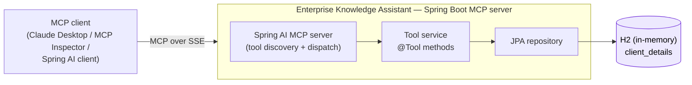

# Enterprise Knowledge Assistant — MCP Server

A **Model Context Protocol (MCP) server** built with **Spring Boot 4 / Java 21** and
**Spring AI**. It exposes an organization's client knowledge base, backed by a relational
database, as a set of **MCP tools** that any MCP-compatible LLM client can discover and
invoke over **SSE**.

> Diagrams use [Mermaid](https://mermaid.js.org/), which GitHub renders automatically.

---

## Overview

The **Model Context Protocol (MCP)** is an open standard that lets an LLM application invoke
external tools through a uniform interface. The client discovers the tools a server
advertises and calls them on demand, rather than relying on hard-coded integrations.

This server advertises **eight read-only tools** over client records (name, relationship
value, tenure in years, and client type). A connected assistant can resolve questions about
clients by selecting and invoking the appropriate tool; the model does not need direct
database or query knowledge.



---

## Tech stack

| Area | Choice |
|------|--------|
| Language / runtime | Java 21 |
| Framework | Spring Boot 4.1.2 (web-mvc, security, actuator) |
| MCP | Spring AI 2.0.1 — `spring-ai-starter-mcp-server` |
| Transport | SSE (Server-Sent Events) |
| Persistence | Spring Data JPA + H2 (in-memory), seeded on startup |
| Build | Maven (`./mvnw`) |

---

## Architecture

Three components turn ordinary Spring beans into MCP tools:

1. **`@Tool`-annotated methods** (`EnterPriseKnowledgeAssistantToolService`) — each method is
   one tool. The `name` and `description` are the metadata the model uses to decide when to
   invoke the tool, so they are written to be unambiguous to the model.

2. **A `ToolCallbackProvider` bean** (`McpToolCallbackProvider`) — registers the service's
   `@Tool` methods with the MCP server:

   ```java
   @Bean
   public ToolCallbackProvider toolCallbackProvider(EnterPriseKnowledgeAssistantToolService svc) {
       return MethodToolCallbackProvider.builder().toolObjects(svc).build();
   }
   ```

3. **Spring AI MCP server starter** — reads `spring.ai.mcp.server.*` configuration, exposes
   the SSE endpoints, advertises the discovered tools, and dispatches incoming tool calls to
   the corresponding methods. No controllers are required.

Request path: **MCP client → SSE → Spring AI MCP server → `@Tool` method → JPA repository → H2.**

---

## Tools

| Tool name | Returns | Repository query |
|-----------|---------|------------------|
| `getAllClientsInformation` | full details of every client | `findAll()` |
| `getAllClientNames` | names of all clients | `findAll()` → names |
| `getUSAClientNames` | names of USA clients | filter `clientType = USA` |
| `getLocalClientNames` | names of non-USA (local) clients | filter `clientType != USA` |
| `getOldestClient` | client with the longest tenure | `findFirstByOrderByNoyDesc` |
| `getNewestClient` | client with the shortest tenure | `findFirstByOrderByNoyAsc` |
| `getMoreValuedClient` | highest relationship-value client | `findFirstByOrderByClientValueDesc` |
| `getLeastValuedClient` | lowest relationship-value client | `findFirstByOrderByClientValueAsc` |

### Data model — `client_details`

| Column | Field | Description |
|--------|-------|-------------|
| `id` | `id` (IDENTITY) | primary key |
| `client_name` | `clientName` | client name |
| `client_value` | `clientValue` | relationship value |
| `no_of_years` | `noy` | tenure in years |
| `client_type` | `clientType` | `USA` or `LOCAL` |

The table is created on startup and seeded from
[`src/main/resources/data.sql`](src/main/resources/data.sql) so the tools return results
without manual setup.

---

## Running the server

```bash
./mvnw spring-boot:run
```

The server starts on **port 8085** (configurable in `application.yml`).

| Endpoint | URL |
|----------|-----|
| SSE (MCP clients connect here) | `http://localhost:8085/sse` |
| H2 console | `http://localhost:8085/h2-console` (JDBC `jdbc:h2:mem:ekadb`, user `sa`, no password) |
| Health | `http://localhost:8085/actuator/health` |

To build and run a packaged jar:

```bash
./mvnw clean package
java -jar target/enterprise-knowledge-assistant-mcp-1.0.jar
```

---

## Connecting a client

**MCP Inspector**

```bash
npx @modelcontextprotocol/inspector
```

Select transport **SSE**, enter `http://localhost:8085/sse`, connect, then open the **Tools**
tab to list and invoke the eight tools.

**Claude Desktop or any SSE-compatible MCP client**

Configure the client with the SSE endpoint `http://localhost:8085/sse`. Once connected, the
model can select and invoke the tools in response to client-data questions.

---

## Configuration reference (`application.yml`)

```yaml
server:
  port: 8085

spring:
  datasource:                       # in-memory H2
    url: jdbc:h2:mem:ekadb;DB_CLOSE_DELAY=-1
  jpa:
    hibernate:
      ddl-auto: create-drop         # schema generated from the @Entity
    defer-datasource-initialization: true   # create the schema before running data.sql
  sql:
    init:
      mode: always                  # run data.sql on startup
  h2:
    console:
      enabled: true

  ai:
    mcp:
      server:
        name: enterprise-knowledge-assistant-mcp
        protocol: sse               # transport
        sse-endpoint: /sse
        sse-message-endpoint: /mcp/message
        type: async
        capabilities:
          tool: true                # this server exposes tools only
        instructions: "This MCP server provides information on enterprise knowledge."
```

> `defer-datasource-initialization: true` ensures Hibernate creates the schema before
> `data.sql` runs; without it, the seed insert executes against a table that does not yet
> exist.

---

## Project layout

```
src/main/java/com/tekmaturix/enterpriseknowledgeassistantmcp
├── EnterpriseKnowledgeAssistantMcpApplication   # Spring Boot entry point
├── config/
│   ├── McpToolCallbackProvider                  # registers @Tool methods with MCP
│   └── SecurityConfig                           # security filter chain
├── model/
│   └── ClientDetail                             # JPA entity (client_details)
├── repo/
│   └── EnterPriseKnowledgeAssistantToolRepo     # Spring Data JPA queries
└── service/
    └── EnterPriseKnowledgeAssistantToolService  # the eight @Tool methods
src/main/resources
├── application.yml                              # server + MCP + H2/JPA configuration
└── data.sql                                     # seed data
```

---

## Notes

- This is a demonstration project. The in-memory H2 database uses `create-drop`, so data is
  reset on each restart and re-seeded from `data.sql`. Use a file-based H2 instance or an
  external database for persistence.
- All tools are read-only.
- The security filter chain currently permits all requests for local development.
  Add authentication before exposing the server beyond a trusted environment.
- The single-result tools (`getOldestClient`, `getNewestClient`, `getMoreValuedClient`,
  `getLeastValuedClient`) require at least one record; the seed data satisfies this.
